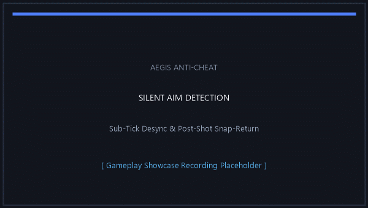
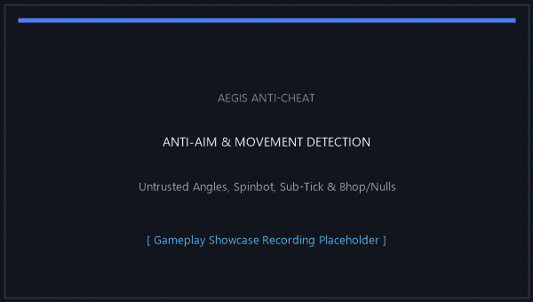
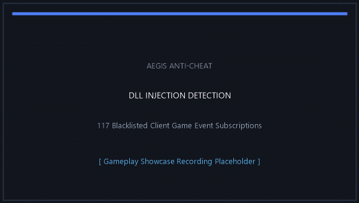

<div align="center">

<p align="center">
  
</p>

# AegisAC (Aegis Anti-Cheat)

**A Server-Sided Anti-Cheat for Counter-Strike 2 built with SwiftlyS2**

[](https://store.steampowered.com/app/730/CounterStrike_2/)
[](https://swiftlys2.net)
[](https://dotnet.microsoft.com/)
[](LICENSE)

<br/>

*A high-performance, non-intrusive server-side anti-cheat built with modern C# on the SwiftlyS2 framework. Detects aim assistance, silent aim, triggerbots, wall-occluded aimlocks, sub-tick tampering, movement automation, exploits, client ConVar manipulation, injected cheat event hooks, and features real-time server-side network entity occlusion (Anti-WallHack / Fog of War) without requiring any client-side software.*

---

</div>

## 📌 Table of Contents

- [Overview](#-overview)
- [Showcase](#-showcase)
- [Key Features](#-key-features)
- [Architecture & Modular Design](#-architecture--modular-design)
- [Detection Modules & Categories](#-detection-modules--categories)
  - [Category I — Aim & Trajectory Analysis (`Aimbot` & `SilentAim`)](#-category-i--aim--trajectory-analysis-aimbot--silentaim)
  - [Category II — Reaction Timing, Wall-Tracking & Network Occlusion (`Triggerbot`, `Aimlock` & `AntiWallHack`)](#-category-ii--reaction-timing-wall-tracking--network-occlusion-triggerbot-aimlock--antiwallhack)
  - [Category III — Protocol, Movement, Exploits & Client Integrity (`AntiAim`, `Movement`, `Exploits`, `DllInjection` & `CVarScanner`)](#️-category-iii--protocol-movement-exploits--client-integrity-antiaim-movement-exploits-dllinjection--cvarscanner)
- [Commercial Anti-Cheat Reverse-Engineering & Mathematical Baselines](#-commercial-anti-cheat-reverse-engineering-engine-invariants--empirical-hypotheses)
- [Quick Start](#-quick-start)
  - [Prerequisites](#prerequisites)
  - [Installation](#installation)
  - [Building from Source](#building-from-source)
- [Configuration Reference](#-configuration-reference)
- [Server Commands](#-server-commands)
- [Discord Webhook Notifications](#-discord-webhook-notifications)
- [Community Calibration & Telemetry](#-aegistelemetry--community-driven-calibration)
- [Frequently Asked Questions (FAQ)](#-frequently-asked-questions-faq)
- [Contributing](#-contributing)
- [License](#-license)

---

## 📖 Overview

**AegisAC** provides servers with robust, automated detection against aimbots, silent aim, triggerbots, wall-occluded aimlocks, sub-tick manipulation, movement macros, internal cheat event hooks, client convar tampering, and server-side wallhack occlusion in Counter-Strike 2. Unlike invasive kernel-level drivers or third-party client anti-cheats, AegisAC runs **strictly on the server**:

- **Zero Client Overhead:** Players do not need to download or install background software.
- **Sub-Tick Phase Aware:** Designed from the ground up to operate seamlessly with CS2's usercmd and sub-tick architecture.
- **Server-Side Anti-WallHack:** Directly hooks engine entity transmission (`CheckTransmit`) to withhold occluded enemy pawns and equipment from network packets, neutralizing ESP/wallhacks entirely.
- **Evidence-Based Sanctions:** Punishments are only executed when multiple, high-confidence evidence points are collected across a sliding time window, mitigating false positives.
- **Extensible Architecture:** Modular design allowing server owners to select independent punishment types (`ban`, `kick`, or `none`) and granular settings for each of the **10 dedicated detection modules**.

---

## 🎥 Showcase

<table>
<tr>
<td width="50%" align="center">

<br><strong>🎯 AIMBOT &amp; RCS</strong><br>
<sub>Damaging shots following blatant angular snaps, mechanical curve smoothing, and robotic spray recoil compensation.</sub>
</td>
<td width="50%" align="center">

<br><strong>👻 SILENT AIM &amp; SNAP-RETURN</strong><br>
<sub>Sub-tick camera/attack angle desynchronization beyond weapon spread and 1-tick post-shot snap-returns.</sub>
</td>
</tr>
<tr>
<td width="50%" align="center">

<br><strong>⚡ TRIGGERBOT &amp; SYNTHETIC INPUT</strong><br>
<sub>Instantaneous weapon discharges (≤90ms command delta), macro variance cadence, and sub-2-tick click injection.</sub>
</td>
<td width="50%" align="center">

<br><strong>🧱 AIMLOCK (WALL TRACKING)</strong><br>
<sub>Crosshair adhering mechanically to a moving enemy through solid world geometry with ≥95% hull coverage.</sub>
</td>
</tr>
<tr>
<td width="50%" align="center">

<br><strong>🌀 ANTI-AIM, SUB-TICK &amp; MOVEMENT</strong><br>
<sub>Untrusted angles, 3-tier Spinbot, Yaw Jitter, Desubticking, AutoStrafe, Bhop, and airborne Nulls / Snap-Tap.</sub>
</td>
<td width="50%" align="center">

<br><strong>💉 DLL INJECTION (CLIENT EVENTS)</strong><br>
<sub>Staggered background inspection of 117 blacklisted Source 2 game event subscriptions registered by internal cheats.</sub>
</td>
</tr>
</table>

---

## ✨ Key Features

- **🎯 Advanced Trajectory & Angle Math:** Employs forward vector trigonometry, angular distance delta checking, and historical position reconciliation to detect instantaneous snaps and unnatural aimbot movement.
- **🔄 Sub-Tick & Phase-Compensated Correlator:** Reliably pairs `weapon_fire` and `player_hurt` events with exact user commands, compensating for client tick gaps and engine phase shifts.
- **👁️ Server-Side Anti-WallHack (Fog of War):** Suppresses network entity transmission (`ISource2GameEntities::CheckTransmit`) for enemies occluded behind solid world geometry, neutralizing client-side ESP and radar hacks without pop-in glitches.
- **🏃 Dedicated Movement Automation Detection:** Independent detection for bunnyhopping (hyperscroll/script), Snap-Tap / airborne Nulls (SOCD opposite-key cancellation), and AutoStrafe optimizers.
- **🛡️ Exploits & Input Integrity:** Catches sub-tick command timestamp tampering, desubtick exploits, invalid usercmd input bits, and name-changer spam.
- **🔍 Client ConVar Verification (CVarScanner):** Queries and verifies critical client-side console variables (`sv_cheats`, `r_drawothermodels`, `mat_wireframe`, `host_timescale`, `fog_enable`, prediction/lag-compensation cvars).
- **⚖️ Flexible Admin & Punishment System:** Native presets for default Swiftly commands (`sw_ban #{userid}`), T3Admin (`sw_addban {steamid}`), or custom format templates with placeholders (`{userid}`, `{slot}`, `{steamid}`, `{name}`, `{reason}`).
- **🔔 Discord Webhook Integration:** Instant, rich embed alerts dispatched asynchronously to your staff Discord channel when a player is flagged, kicked, or banned.
- **⚡ Hot Reloading & Live Config:** Reload configurations instantaneously during live gameplay with the `aegis_reload` command without restarting the server or kicking players.
- **🔍 Unified Diagnostic Suite:** Inspect live telemetry per module (`aegis_status`, `aimbot_status`, `silentaim_status`, `triggerbot_status`, `aimlock_status`, `antiaim_status`, `movement_status`, `exploits_status`, `dllinjection_status`, `cvar_status`, `awh_status`).

---

## 🏛️ Architecture & Modular Design

AegisAC enforces a clean architectural separation between detection logic and utility helpers:

- **`src/Modules/`:** Contains **strictly** the 10 dedicated detector classes:
  - `Aimbot.cs`
  - `SilentAim.cs`
  - `Triggerbot.cs`
  - `Aimlock.cs`
  - `AntiWallHack.cs`
  - `AntiAim.cs`
  - `Movement.cs`
  - `Exploits.cs`
  - `DllInjection.cs`
  - `CVarScanner.cs`
- **`src/Utils/`:** Houses all reusable geometric math, network monitors, unmanaged engine hooks, and visibility tracers:
  - `AimMath.cs` — Trigonometry, geodesic angular distances, and Vanguard/Overwatch baselines.
  - `NetworkSafetyMonitor.cs` — Sliding-window latency, jitter, loss, and choke tracking to prevent false flags during network lag.
  - `Utils.cs` — Logging, console styling, chat printing, and debug helpers.
  - `AntiWallHack/CornerPredictor.cs` — Predictive corner-peeking velocity and directional input lead calculator.
  - `AntiWallHack/OcclusionTracer.cs` — 12-sample ray tracing engine with previous-hit caching and per-tick trace budgets.
  - `AntiWallHack/TransmitHook.cs` — Unmanaged vtable hook for `ISource2GameEntities::CheckTransmit` and mask bit twiddling.
  - `AntiWallHack/VisibilityTracker.cs` — Player snapshot builder, scene node & equipment bundle aggregator, and grace period smoothing.

---

## 🛡️ Detection Modules & Categories

AegisAC is structured into **3 distinct categories** comprising **10 dedicated server-side modules**:

| Category | Module (`src/Modules/`) | Config Section | Status Command | Primary Detections / Actions |
| :--- | :--- | :--- | :--- | :--- |
| **🎯 I. Aim & Trajectory** | [`Aimbot.cs`](src/Modules/Aimbot.cs) | `Aimbot` | `aimbot_status` | `AIMBOT` (Snap, Smooth, Laser), `RCS_MACRO`, `INHUMAN_ACCURACY`, `IRREGULAR_BEHAVIOR`, `DOUBLETAP` |
| **🎯 I. Aim & Trajectory** | [`SilentAim.cs`](src/Modules/SilentAim.cs) | `SilentAim` | `silentaim_status` | `SILENT_AIM` (Sub-Tick Desync + Geodesic Path Filter), `SNAP_RETURN` |
| **⚡ II. Reaction & Tracking** | [`Triggerbot.cs`](src/Modules/Triggerbot.cs) | `Triggerbot` | `triggerbot_status` | `TRIGGERBOT` (`TargetDriven` & `AimDriven` + Variance), `SYNTHETIC_INPUT` |
| **⚡ II. Reaction & Tracking** | [`Aimlock.cs`](src/Modules/Aimlock.cs) | `Aimlock` | `aimlock_status` | `AIMLOCK` (Wall-Occluded 64-Tick Hull Adherence) |
| **⚡ II. Reaction & Tracking** | [`AntiWallHack.cs`](src/Modules/AntiWallHack.cs) | `AntiWallHack` | `awh_status` | **Server-Side Entity Occlusion (Fog of War)**: Suppresses network packets for occluded enemies & weapons |
| **🛡️ III. Protocol & Integrity** | [`AntiAim.cs`](src/Modules/AntiAim.cs) | `AntiAim` | `antiaim_status` | `ANTI_UNTRUSTED` (pitch/roll/finite), `Spinbot` (3-tier rate), `Yaw Jitter Anti-Aim` |
| **🛡️ III. Protocol & Integrity** | [`Movement.cs`](src/Modules/Movement.cs) | `Movement` | `movement_status` | `Bhop` (consecutive frame-perfect landings), `Nulls` (SOCD / Snap-Tap 0.00ms switch), `AutoStrafe` |
| **🛡️ III. Protocol & Integrity** | [`Exploits.cs`](src/Modules/Exploits.cs) | `Exploits` | `exploits_status` | `Subtick Tamper` (non-monotonic timestamps), `Desubtick`, `Invalid Input` bits, `NameChanger` |
| **🛡️ III. Protocol & Integrity** | [`DllInjection.cs`](src/Modules/DllInjection.cs) | `DllInjection` | `dllinjection_status` | `DLL Injection` (117 Blacklisted Client Game Event Subscriptions) |
| **🛡️ III. Protocol & Integrity** | [`CVarScanner.cs`](src/Modules/CVarScanner.cs) | `CVarScanner` | `cvar_status` | `CVar Manipulation` (`sv_cheats`, `r_drawothermodels`, `mat_wireframe`, `host_timescale`, `fog_enable`, etc.) |

---

### 🎯 Category I — Aim & Trajectory Analysis (`Aimbot` & `SilentAim`)

> [!IMPORTANT]
> **Category I Focus:** Inspects user commands, view-angle trajectories, sub-tick attack history, weapon spread cones, and confirmed damage (`player_hurt` / `player_death`) to catch ragebots, closet smooth aimbots, silent aim, and recoil macros.

<details open>
<summary><b>Module 1: Aimbot, RCS &amp; Combat Anomaly Detection (<code>src/Modules/Aimbot.cs</code>)</b></summary>
<br/>

The Aimbot detector inspects user commands, view angles, weapon fire correlation, and player damage to identify automated targeting mechanics.

#### Detection Methods

1. **Convergence Snap Detection (`AIMBOT`)**
   - **How it works:** Analyzes the angular delta between the player's view angles before and after a shot using multi-hypothesis lag-compensated target positions. Catches blatant rage snaps ($\ge 90^\circ$ in $<16\text{ms}$ or $\ge 45^\circ$ onto target), standard snaps ($\ge \text{SnapAngleThreshold}$), and isolated 1-tick closet snaps ($3.5^\circ\text{–}10.0^\circ$).
   - **Trigger Condition:** Shot must inflict confirmed damage (`player_hurt`), target distance must exceed `100.0` game units, and aim must resolve directly onto enemy hitboxes.

2. **Smooth Convergence Detection — Standard, Closet Low-FOV & Laser (`AIMBOT`)**
   - **How it works:** Identifies mechanical curve-smoothing aimbots using a backward-anchored convergence window from the damaging shot. Evaluates path efficiency, directional sign-reversal count (`jitterFlips == 0`), step variance (`MIN_VARIANCE < 0.05`), and relative step coefficient of variation (`PATTERN_VARIANCE < 8.157%`).
   - **Trigger Condition:** Catches both decelerating exponential smoothers and constant-velocity linear smoothers across standard FOV (`SmoothMinimumMovement` ≥ 12.0°) and closet low-FOV (`LowFovSmoothMinimumMovement` ≥ 3.5°), while rejecting legitimate human ballistic flicks that contain overshoot or micro-correction reversals.

3. **No-Recoil / RCS Macro Pattern Detection (`RCS_MACRO`)**
   - **How it works:** Evaluates continuous automatic rifle/SMG spray bursts ($\ge 8$ bullets) against `RECOIL_THRESHOLD` ($\ge 80\%$ vertical pull-down compensation) and `PATTERN_VARIANCE` ($< 8.157\%$ inter-shot step coefficient of variation with zero sign reversals).
   - **Trigger Condition:** Requires sustained robotic spray uniformity across multiple bursts, ignoring natural human spray control.

4. **Sustained Inhuman Accuracy (`INHUMAN_ACCURACY`) & Irregular Behavior (`IRREGULAR_BEHAVIOR`)**
   - **How it works:** Tracks aimed combat engagements ($\ge 100\text{u}$) against `PREDICTION_THRESHOLD` ($\ge 95\%$ hit rate across $\ge 35$ aimed shots) and scores repeated airborne or sniper no-scope kills at $\ge 10\text{m}$ ($\ge 16$ points with $\ge 50\%$ attempt conversion).

5. **Rapid-Fire / Doubletap Detection (`DOUBLETAP`)**
   - **How it works:** Verifies consecutive `weapon_fire` tick intervals against theoretical minimum weapon cycle times per weapon, gated by `NetworkSafetyMonitor` to ignore packet-burst artifacts.

</details>

<details open>
<summary><b>Module 2: Silent Aim &amp; Snap-Return Detection (<code>src/Modules/SilentAim.cs</code>)</b></summary>
<br/>

Dedicated module separating sub-tick angle desynchronization and post-shot snap-returns from standard Aimbot trajectory convergence.

#### Detection Methods

1. **Sub-Tick Silent Aim (`SILENT_AIM`)**
   - **How it works:** Compares base command camera angles (`pb.Base.Viewangles`) against sub-tick attack history angles (`input_history[attack1_start_history_index]`), dynamically accounting for weapon inaccuracy/spread (`CMsgTEFireBullets`) and `CSubtickMoveStep` mouse travel.
   - **Adjacent Path Geodesic Filter:** Incorporates the triangle-inequality check (`prevBase -> attack -> base`, `adjacentPathExcess <= 1.0°`) so legitimate mid-sweep sub-tick clicks are never false-flagged.
   - **Trigger Condition:** Weighted point accumulation (`+2.5` to `+10.0` points based on angular excess and airborne state, with `-1.5` normal-hit decay) triggering at `ScoreThreshold` (`10.0` points).

2. **Post-Shot Snap-Return (`SNAP_RETURN`)**
   - **How it works:** Detects 1-tick silent aimbots that jump onto a target on the shot command (`SnapReturnMinimumAngle >= 6.0°`) and immediately return to the prior camera trajectory on the subsequent command (`SnapReturnMaximumSurroundingAngle < 3.5°`).

</details>

---

### ⚡ Category II — Reaction Timing, Wall-Tracking & Network Occlusion (`Triggerbot`, `Aimlock` & `AntiWallHack`)

> [!IMPORTANT]
> **Category II Focus:** Combines native physics raycasts (`MaskTrace.Solid`), anatomical 3-sphere hitbox hulls, smoke volume slab tests, sub-tick timing variance, and server-side packet transmission masks to detect triggerbots, wall-tracking aimlocks, and suppress client-side ESP entirely.

<details open>
<summary><b>Module 3: Triggerbot &amp; Synthetic Input Detection (<code>src/Modules/Triggerbot.cs</code>)</b></summary>
<br/>

The Triggerbot detector inspects real-time crosshair raycast targeting, sub-tick reaction latencies, angle-holding behavior, and smoke boundary occlusion.

#### Detection Methods

1. **Contextual Sub-Tick Reaction & Variance Scoring (`TargetDriven` & `AimDriven`)**
   - **How it works:** Evaluates both stationary angle-holding (`TargetDriven`) and controlled peeking/micro-adjustment sweeps (`AimDriven` ≤ 8.5°/tick) against a crouch-aware 3-zone anatomical hitbox model (head `R=9.0u`, torso/arms `R=17.5u`, legs `R=14.0u`).
   - **Trigger Condition:** Uses a bounded decaying point model (`EvaluateShotPoints`) that catches both `0–1` tick triggerbots and `2–5` tick (`31–78ms`) external triggerbots, awards consistency bonuses when fast reaction variance is near-zero ($\sigma^2 \le 0.65\text{ ticks}^2$), and actively decays score (`-2.5` to `-3.0` pts) on normal human reactions ($\ge 7\text{–}9$ ticks). High-speed ballistic flicks (`> 8.5°/tick`) and continuous pre-fire sprays (`wasAlreadyAttacking`) are ignored.

2. **Isolated Input State-Machine Anomaly Gate (`SYNTHETIC_INPUT`)**
   - **How it works:** Tracks sub-2-tick (`≤ 31.2ms`) fresh click-release-click cycles in an isolated 60-second sliding queue (`SyntheticAnomalyTimes`). A single mechanical switch bounce never contaminates `AimDriven` triggerbot reactions, while sustained synthetic injection (`≥ 5` anomalies in 60s) triggers an independent `SYNTHETIC_INPUT` alert.

3. **Smoke, Line-of-Sight & Network Safety Gates**
   - **World Visibility Gate:** Performs targeted line-of-sight checks against world geometry (`MaskTrace.Solid`) at both target acquisition and `player_hurt` resolution.
   - **Smoke & Network Safety:** Automatically discards shots through active smoke volumes and defers timing-sensitive scoring during high ping (`≥ 150ms`), jitter (`≥ 25ms`), packet loss/choke (`≥ 2%`), or command bursts via `NetworkSafetyMonitor`.

</details>

<details open>
<summary><b>Module 4: Aimlock Wall-Tracking Detection (<code>src/Modules/Aimlock.cs</code>)</b></summary>
<br/>

The Aimlock detector analyzes sustained crosshair adherence through solid world geometry, lag-compensated target tracking, and observed-sample continuity.

#### Detection Methods

1. **Wall-Occluded Hull Tracking & Observed-Sample Verification**
   - **How it works:** Analyzes the player's view angles against crouch-aware enemy hull boundaries across 3 body points over a `1.0`-second window (`64` verified observed ticks). Missing ticks (`serverTickDelta == 2`) are never credited as on-target samples, and episodes reset if more than `3` single-tick gaps or `> 3` consecutive off-target ticks occur.
   - **Trigger Condition:** Sustained crosshair placement covering ≥ 95% of observed ticks (`MeetsCoverage`) while ≥ 70% of on-target samples are occluded behind solid world geometry (`RequireWallOcclusion = true`), eliminating false positives on visible line-of-sight combat tracking.

2. **Lag-Compensated Multi-Hypothesis Verification**
   - **How it works:** Evaluates target position against historical latency hypotheses derived from `NetChannel.EngineLatency` (or `Controller.Ping`) plus the client's `cl_interp_ratio` convar using the shared position buffer.

3. **False-Positive Prevention Gates**
   - **Distance Gate:** Point-blank interactions (< 150 units) are excluded to prevent false triggers during close-quarters collisions.
   - **Target Traversal Gate:** Requires the enemy to have moved at least 128 units across the player's visual field to eliminate false positives on stationary corner-holding.

</details>

<details open>
<summary><b>Module 5: Server-Side Anti-WallHack / Network Occlusion (<code>src/Modules/AntiWallHack.cs</code>)</b></summary>
<br/>

Server-side entity transmission occlusion (Fog of War) that actively neutralizes client-side ESP, wallhacks, and radar cheats without needing any client software.

#### Methods & Mechanics

1. **Unmanaged Engine CheckTransmit Hook**
   - **How it works:** Intercepts `CSource2GameEntities::CheckTransmit` on the server virtual table. Manipulates `primaryMask` and `dontTransmitMask` bit arrays to withhold enemy pawn entities from network packets sent to clients who have no direct line-of-sight.
2. **Multi-Sample 12-Ray Bounding Hull Tracing**
   - **How it works:** Verifies line of sight across 12 critical sample points per target: eye, torso/center of mass, 8 padded bounding box corners, and 2 forward weapon/hip vectors. Employs preferred-sample caching (testing the clear ray from the prior tick first) and per-tick trace budgets (`MaxTracesPerTick = 2048`) to ensure 0% server tickrate degradation.
3. **Corner-Peek Prediction & Grace Period Smoothing**
   - **How it works:** Projects viewer eye positions along forward/strafe velocity vectors and movement button inputs (`CornerPredictionSeconds = 0.12s`) to ensure enemies around corners are transmitted before a peeker appears. Maintains `VisibleGraceTicks = 12` ticks of transmission after line-of-sight is broken to prevent visual flickering.
4. **Complete Entity Bundling**
   - **How it works:** Collects player pawns, scene node hierarchy children (`CGameSceneNode`), and equipped/carried weapons (`CEconEntity`) so no floating weapons or model attachments leak to ESP cheats.

</details>

---

### 🛡️ Category III — Protocol, Movement, Exploits & Client Integrity (`AntiAim`, `Movement`, `Exploits`, `DllInjection` & `CVarScanner`)

> [!IMPORTANT]
> **Category III Focus:** Enforces deterministic Source 2 engine invariants on viewangles, `CSubtickMoveStep` protobuf steps, airborne movement physics, client-side ConVar values, and client-side `IGameEventManager2` event subscriptions.

<details open>
<summary><b>Module 6: Anti-Aim &amp; Spinbot Detection (<code>src/Modules/AntiAim.cs</code>)</b></summary>
<br/>

Validates viewangle limits, spinbots, and rapid angular jitter mechanics.

#### Detection Methods

1. **Anti-Untrusted Angles (`ANTI_UNTRUSTED`)**
   - **How it works:** Deterministically flags invalid pitch angles outside $[-89.0^\circ, +89.0^\circ]$, roll angles exceeding $50.0^\circ$ (with a damage/recoil safety margin), and non-finite `NaN`/`Inf` angles.
2. **Multi-Tier Spinbot & Yaw Jitter (`Spinbot`, `Yaw Jitter Anti-Aim`)**
   - **How it works:** Detects continuous non-combat yaw rotation across 3 tiers (`720°/s`, `1440°/s`, `2880°/s` with $\ge 90\%$ directional consistency) and rapid alternating yaw jitter flips ($\ge 65^\circ$).

</details>

<details open>
<summary><b>Module 7: Movement Automation Detection (<code>src/Modules/Movement.cs</code>)</b></summary>
<br/>

Specialized detection for bunnyhop macros/scripts, Snap-Tap / airborne Nulls, and AutoStrafe optimizers.

#### Detection Methods

1. **Bunnyhop Hyperscroll & Macro Detection (`Bhop`)**
   - **How it works:** Analyzes ground contact states, tick intervals, and `IN_JUMP` buttons. Flags consecutive frame-perfect single-tick jumps when landing (`BhopStreakThreshold = 10`), ignoring legitimate manual scroll-wheel inputs with multi-tick spreads.
2. **Airborne Nulls / Snap-Tap SOCD Detection (`Nulls`)**
   - **How it works:** Analyzes opposite horizontal directional transitions (`IN_MOVELEFT` $\leftrightarrow$ `IN_MOVERIGHT`). Detects automated hardware/software SOCD cancellations where opposite-direction switches occur at instantaneous `0.00ms` latency without release overlap over consecutive airborne strafes (`NullsStreakThreshold = 64`).
3. **AutoStrafe & Strafe Optimizer Detection (`AutoStrafe`)**
   - **How it works:** Correlates viewangle yaw acceleration against airborne lateral velocity gains to detect mathematical strafe synchronization exceeding human coordination limits (`YawAccelPercent > 90%`).

</details>

<details open>
<summary><b>Module 8: Exploits &amp; Input Integrity Detection (<code>src/Modules/Exploits.cs</code>)</b></summary>
<br/>

Guards against protocol-level tampering, usercmd sub-tick manipulation, and exploit scripts.

#### Detection Methods

1. **Sub-Tick Timestamp Tampering (`Subtick Tamper`)**
   - **How it works:** Enforces monotonic sub-tick timestamp ordering in `CSubtickMoveStep` protobuf data. Flags commands where fractional timestamps decrease or step backwards in time.
2. **Desubtick Exploit Detection (`Desubtick`)**
   - **How it works:** Identifies third-party desubtick scripts and binds that strip fractional sub-tick precision, forcing all button actions to clamp artificially to `0.0`.
3. **Invalid Input Bitmasks (`Invalid Input`)**
   - **How it works:** Validates consistency between command button bitmasks (`buttonstate1`, `buttonstate2`, `buttonstate3`) and registered sub-tick actions.
4. **Name-Changer Spam (`NameChanger`)**
   - **How it works:** Detects malicious automated scripts rapidly changing player names to flood server logs or impersonate administrators.

</details>

<details open>
<summary><b>Module 9: Client Event Subscription / DLL Injection Detection (<code>src/Modules/DllInjection.cs</code>)</b></summary>
<br/>

Scans for injected internal cheat modules hooking engine event dispatchers.

#### Detection Methods

1. **Blacklisted Source 2 Game Event Subscription Scanner (`DLL Injection`)**
   - **How it works:** Uses `IGameEventService.IsListeningToEvent` on a staggered background schedule (`InitialScanDelaySeconds = 10s`, `ScanIntervalSeconds = 120s`, at most 1 player scanned per tick) to check if a client is subscribed to any of **117 blacklisted game events** (e.g. `bullet_damage`, `bullet_flight_resolution`, `player_shoot`, `gameui_hidden`) that legitimate CS2 clients never register, but injected internal cheats subscribe to via `IGameEventManager2::AddListener`.

</details>

<details open>
<summary><b>Module 10: Client ConVar Verification (<code>src/Modules/CVarScanner.cs</code>)</b></summary>
<br/>

Verifies critical client-side console variables to prevent client-side visual and physics exploits.

#### Detection Methods

1. **Client ConVar Query Verification (`CVar Manipulation`)**
   - **How it works:** Queries client cvars via SwiftlyS2 query mechanisms on a periodic schedule (`InitialScanDelaySeconds = 15s`, `ScanIntervalSeconds = 90s`). Verifies:
     - `sv_cheats` — Ensures client has not forced bypass of cheat flags.
     - `r_drawothermodels` — Prevents client-side built-in wallhacks (`r_drawothermodels 2`).
     - `mat_wireframe` — Prevents client-side wireframe geometry rendering.
     - `host_timescale` — Prevents client speedhacking/timescale alteration.
     - `fog_enable` — Prevents client-side smoke and fog removal.
     - `cl_predict` & `cl_lagcompensation` — Verifies prediction integrity.

</details>

---

## 🔬 Commercial Anti-Cheat Reverse-Engineering, Engine Invariants & Empirical Hypotheses

AegisAC formalizes all **8 reverse-engineered Riot Vanguard & Blizzard Overwatch metrics** in [`AimMath.Baselines`](src/Utils/AimMath.cs) alongside verified CS2 engine invariants:

| Metric / Gate | Threshold (`AimMath.Baselines`) | AegisAC Implementation & Calibration | Detection Target |
| :--- | :--- | :--- | :--- |
| **`SNAP_TRESHOLD`** | **`90.0°` in `< 16ms` (`1 tick`)** | **Blatant Rage Snap Gate:** Single-tick ($15.625\text{ms}$) angular snaps $\ge 90.0^\circ$ (or $\ge 45.0^\circ$ onto target) trigger immediate high-confidence detection (`threshold = 1`). Calibrated subtle/isolated convergence covers $3.5^\circ\text{–}26.0^\circ$. | Aimbot (`Aimbot.cs`) |
| **`MIN_HUMAN_REACTION`** | **`150.0ms` (`9 ticks` @ 64Hz)** | **Contextual Decaying Reaction Model:** Defines the psychophysical visual reaction floor (`MinHumanReactionTicks = 9`). Hits within $\le 90\text{ms}$ accrue weighted points, while normal human reactions ($\ge 7\text{–}9$ ticks) actively decay accumulated score. | TriggerBot / Bot (`Triggerbot.cs`) |
| **`MACRO_TRESHOLD`** | **`variance < 0.01`** | **Robotic Macro Cadence Bonus:** `EvaluateShotPoints` awards maximum `+4.0` consistency bonus when reaction variance across $\ge 4$ fast shots is near-zero ($\sigma^2 \le 0.01\text{ ticks}^2$). | Macro (`Triggerbot.cs`) |
| **`MIN_CLICK_VARIANCE`** | **`0.05`** | **Sub-Tick Click Variance Gate:** Awards `+3.0` consistency points when fast triggerbot reaction variance falls below `MinClickVariance` ($\sigma^2 \le 0.05\text{ ticks}^2$), and isolates $\le 2$-tick click-release-click injection (`SYNTHETIC_INPUT`). | Macro / Synthetic Click (`Triggerbot.cs`) |
| **`MIN_VARIANCE`** | **`0.05`** | **Constant-Velocity Linear Smoother Gate:** Flags smooth aimbot trajectories whose per-tick angular step variance falls below `MinBotVariance` ($\sigma^2 \le 0.05\text{ deg}^2$) with zero directional sign flips (`jitterFlips == 0`). | Bot / Linear Smoother (`Aimbot.cs`) |
| **`PREDICTION_TRESHOLD`** | **`> 95.0%` accuracy (`0.95`)** | **Hull Coverage & Inhuman Accuracy:** Enforces $\ge 95\%$ on-target hull coverage for wall-occluded `Aimlock` episodes and flags $\ge 95\%$ hit accuracy across $\ge 35$ aimed combat shots at $\ge 100\text{u}$ (`INHUMAN_ACCURACY`). | Aimbot / Aimlock (`Aimlock.cs`, `Aimbot.cs`) |
| **`RECOIL_TRESHOLD`** | **`< 0.80` comp (`80%`)** | **Spray Recoil Compensation Gate:** Evaluates $\ge 8$-shot automatic rifle/SMG sprays where vertical pull-down compensation meets $\ge 80\%$ of expected recoil envelope combined with robotic pattern uniformity. | RCS / No-Recoil (`Aimbot.cs`) |
| **`PATTERN_VARIANCE`** | **`< 8.157%` (`CV < 0.08157`)** | **Relative Step Coefficient of Variation Gate:** Active across `EvaluateSprayRecoilPattern` (`RCS_MACRO`), `SmoothConvergence` (`AIMBOT`), and `EvaluateShotPoints` (`TRIGGERBOT`) whenever relative step CV falls below `8.157%`. | Pattern Detection (`Aimbot.cs`, `Triggerbot.cs`) |
| **`ANTI_UNTRUSTED` & `SubtickMoves`** | **Verified CS2 Engine Invariant** | Clamps pitch to $[-89.0^\circ, +89.0^\circ]$, roll to $50.0^\circ$, validates `CSubtickMoveStep` monotonic button ordering, and scans **117 blacklisted client game events** (`DLL Injection`). | Anti-Aim / Subtick / DLL Injection (`AntiAim.cs`, `DllInjection.cs`) |

---

## 🚀 Quick Start

### Prerequisites

- Counter-Strike 2 Dedicated Server.
- [.NET 10.0 Runtime](https://dotnet.microsoft.com/download/dotnet/10.0) installed on the host machine.
- [SwiftlyS2 Framework](https://swiftlys2.net/) (v1.1.6 or newer) installed in `game/csgo/addons/swiftlys2`.

### Installation

1. Download the latest release `.zip` from the [Releases](https://github.com/ressiws/AegisAC/releases) page.
2. Extract the archive into your server's plugin directory:
   ```
   game/csgo/addons/swiftlys2/plugins/AegisAC/
   ```
3. Start or restart your server. SwiftlyS2 will automatically detect and load `AegisAC.dll`.
4. On first load, AegisAC automatically generates the default configuration file:
   ```
   game/csgo/addons/swiftlys2/configs/plugins/AegisAC/config.jsonc
   ```

### Building from Source

To compile the plugin and run the unit test suite locally:

```bash
# Clone the repository
git clone https://github.com/ressiws/AegisAC.git
cd AegisAC

# Build in Release configuration
dotnet build -c Release

# Run the deterministic xUnit test suite (47 tests)
dotnet test tests/AegisAC.Tests/AegisAC.Tests.csproj -c Release

# Package and publish
dotnet publish -c Release
```

The compiled binaries will be output to `build/publish/AegisAC/`.

---

## ⚙️ Configuration Reference

AegisAC configurations are stored in `addons/swiftlys2/configs/plugins/AegisAC/config.jsonc`. Every detection module has its own dedicated configuration block with independent `Enabled` and `Punishment` controls:

```jsonc
{
  "AegisAC": {
    // Unique server identifier included in Discord alerts and logs.
    "ServerId": "cs2-server-1",

    // Global debug mode for Aegis Anti-Cheat. Enables diagnostic console messages and in-game status commands.
    "Debug": false,

    // Admin ban system preset: 'Default' (sw_ban #{userid}), 'T3Admin' (sw_addban {steamid}), or 'Custom' (uses BanCommand / KickCommand).
    "AdminSystem": "Default",

    // Server console command template executed for kicking. Available placeholders: {userid}, {slot}, {steamid}, {name}, {reason}.
    "KickCommand": "sw_kick #{userid} \"[AegisAC] {reason}\"",

    // Server console command template executed for banning when AdminSystem is 'Custom'. Available placeholders: {userid}, {slot}, {steamid}, {name}, {reason}.
    "BanCommand": "sw_ban #{userid} 0 \"[AegisAC] {reason}\"",

    // 1. Aimbot, RCS, Doubletap, Inhuman Accuracy & Irregular Behavior module
    "Aimbot": {
      "Enabled": true,
      "Punishment": "None",
      "TeammatesAreEnemies": false,
      "SnapAngleThreshold": 26.0,
      "SmoothMinimumMovement": 12.0,
      "LowFovSmoothMinimumMovement": 3.5,
      "SmoothMinimumPathEfficiency": 0.96,
      "EnableSilentAim": true,
      "EnableDoubletap": true,
      "EnableAntiAim": true
    },

    // 2. Dedicated Silent Aim & Post-Shot Snap-Return module
    "SilentAim": {
      "Enabled": true,
      "Punishment": "None",
      "ScoreThreshold": 10.0,
      "EnableSubtickSilentAim": true,
      "EnableSnapReturn": true
    },

    // 3. Triggerbot & Synthetic Input module
    "Triggerbot": {
      "Enabled": true,
      "Punishment": "None",
      "EvidenceThreshold": 4,
      "MaxReactionTimeMs": 90.0,
      "EnableNativeTrace": true,
      "EnableSmokeCheck": true
    },

    // 4. Aimlock (Wall-Occluded Tracking) module
    "Aimlock": {
      "Enabled": true,
      "Punishment": "None",
      "EvidenceThreshold": 3,
      "TrackingDurationSeconds": 1.0,
      "MinimumDistance": 150.0,
      "MinimumTargetTravel": 128.0,
      "RequireWallOcclusion": true
    },

    // 5. Anti-Aim & Spinbot module
    "AntiAim": {
      "Enabled": true,
      "Punishment": "None",
      "EnableUntrustedCheck": true,
      "EnableSpinbotCheck": true
    },

    // 6. Movement Automation (Bhop, Nulls / Snap-Tap, AutoStrafe) module
    "Movement": {
      "Enabled": true,
      "Punishment": "None",
      "EnableBhopCheck": true,
      "BhopStreakThreshold": 10,
      "EnableNullsCheck": true,
      "NullsStreakThreshold": 64,
      "EnableAutoStrafeCheck": true
    },

    // 7. Exploits & Input Integrity (Subtick Tamper, Desubtick, Invalid Input, NameChanger) module
    "Exploits": {
      "Enabled": true,
      "Punishment": "None",
      "EnableSubtickTamperCheck": true,
      "EnableDesubtickCheck": true,
      "EnableInvalidInputCheck": true,
      "EnableNameChangerCheck": true
    },

    // 8. Client Event Subscription (DLL Injection) scanner module
    "DllInjection": {
      "Enabled": true,
      "Punishment": "None",
      "InitialScanDelaySeconds": 10.0,
      "ScanIntervalSeconds": 120.0
    },

    // 9. Client ConVar verification (CVarScanner) module
    "CVarScanner": {
      "Enabled": true,
      "Punishment": "None",
      "InitialScanDelaySeconds": 15.0,
      "ScanIntervalSeconds": 90.0,
      "CheckDrawOtherModels": true,
      "CheckMatWireframe": true,
      "CheckSvCheats": true,
      "CheckHostTimescale": true,
      "CheckFogEnable": true,
      "CheckPredictionAndLagComp": true
    },

    // 10. Server-Side Anti-WallHack (Fog of War) module
    "AntiWallHack": {
      "Enabled": true,
      "CornerPrediction": true,
      "CornerPredictionSeconds": 0.12,
      "VisibleGraceTicks": 12,
      "MaxTracesPerTick": 2048
    },

    // Incident telemetry & demo proof JSON dump configuration
    "Telemetry": {
      "DumpIncidents": true,
      "IncidentsDirectory": "logs/aegisac/incidents"
    },

    // Discord webhook notifications
    "Discord": {
      "Enabled": false,
      "WebhookUrl": ""
    }
  }
}
```

---

## 💻 Server Commands

All commands can be executed via the server console or in-game by authorized administrators (`@css/root`).

| Command | Aliases | Permission | Description |
| :--- | :--- | :--- | :--- |
| `aegis_reload` | `aegisreload` | `@css/root` | Reloads `config.jsonc` dynamically across all 10 modules without restarting the server. |
| `aegis_status` | `aegisstatus` | `@css/root` | Prints a unified real-time telemetry summary of all 10 detection modules (`Debug: true`). |
| `aimbot_status` | — | `@css/root` | Prints real-time `AimbotDetector` statistics, command correlation, and buffers (`Debug: true`). |
| `silentaim_status` | — | `@css/root` | Prints real-time `SilentAimDetector` sub-tick and snap-return counters (`Debug: true`). |
| `triggerbot_status` | — | `@css/root` | Prints real-time `TriggerbotDetector` statistics and active smoke volumes (`Debug: true`). |
| `aimlock_status` | — | `@css/root` | Prints real-time `AimlockDetector` statistics and wall-tracking sessions (`Debug: true`). |
| `antiaim_status` | — | `@css/root` | Prints real-time `AntiAimDetector` untrusted, spinbot, and jitter counters (`Debug: true`). |
| `movement_status` | — | `@css/root` | Prints real-time `MovementDetector` Bhop, Nulls, and AutoStrafe counters (`Debug: true`). |
| `exploits_status` | — | `@css/root` | Prints real-time `ExploitsDetector` subtick tamper, desubtick, and input integrity counters (`Debug: true`). |
| `dllinjection_status` | — | `@css/root` | Prints real-time `DllInjectionDetector` event blacklist scan counters (`Debug: true`). |
| `cvar_status` | — | `@css/root` | Prints real-time `CVarScannerDetector` client console variable verification counters (`Debug: true`). |
| `awh_status` | `antiwallhack_status` | `@css/root` | Prints real-time `AntiWallHackDetector` occluded pairs, trace budgets, and hook status (`Debug: true`). |

---

## 🔔 Discord Webhook Notifications

AegisAC features native **Discord Components V2** webhook alerts with structured containers, dynamic accent colors, markdown formatting, and incident telemetry:

```
┌────────────────────────────────────────────────────────┐
│ 🛡️ Aegis Anti-Cheat  APP                               │
│ CS2 · Server-Sided Protection                          │
│ ────────────────────────────────────────────────────── │
│ 🚨 CHEATER DETECTED                                    │
│ Player Swisser has been flagged by Aegis Anti-Cheat.   │
│ ────────────────────────────────────────────────────── │
│ Player Information                                     │
│ PLAYER: Swisser                                        │
│ STEAM ID: 76561198...                                  │
│ MODULE: Aimbot                                         │
│ ────────────────────────────────────────────────────── │
│ Detection & Action                                     │
│ DETECTION: AIMBOT                                      │
│ ACTION TAKEN: 🔴 BANNED                                │
│ ────────────────────────────────────────────────────── │
│ 📊 Incident Evidence                                   │
│ 1. 47.52° sudden move (10.86° → 1.62°)                 │
│ 2. 82.14° sudden move (14.20° → 0.95°)                 │
│ 3. 123.28° sudden move (18.40° → 0.81°)                │
│ ────────────────────────────────────────────────────── │
│ AEGIS ANTI-CHEAT FOR CS2 · SERVER-SIDED PROTECTION     │
│ └──────────────────────────────────────────────────────┘
```

- **Non-blocking:** Embeds are dispatched in an asynchronous background worker pool, guaranteeing zero frame drops or lag spikes on the game thread.
- **Color-Coded:** Red for Bans, Orange for Kicks, Gold/Yellow for Logged alerts.
- **Steam Profile Links:** Direct clickable links to the flagged player's Steam Community profile.

---

## 📊 AegisTelemetry & Community-Driven Calibration

> **Every CS2 server community is unique.** A competitive 5v5 scrim server, an intensive FFA Deathmatch network, and a casual community feature vastly different player movement speeds, flick ranges, and reaction profiles.

To discover the optimal, false-positive-proof detection thresholds tailored specifically to **your community**, you can pair AegisAC with our companion open-source project: **[AegisTelemetry](https://github.com/ressiws/AegisTelemetry)**.

### What is AegisTelemetry?
[AegisTelemetry](https://github.com/ressiws/AegisTelemetry) is a dedicated SwiftlyS2 telemetry collector and interactive Web Dashboard designed to calibrate anti-cheat settings directly from live server data:

- 📡 **Silent Server Telemetry:** Records high-frequency sub-tick metrics (flick snap angles, mouse path efficiency, reaction times upon target intersection, continuous aimlock tracking durations) directly into MariaDB/MySQL without blocking the server game tick.
- 📈 **Interactive Web Dashboard:** Launch `AegisTelemetry.Dashboard` to visualize real-world percentile distributions ($P_{50}$, $P_{90}$, $P_{95}$, $P_{99}$) and histograms across all weapons and maps.
- 🥷 **Cheater Intelligence & Quarantine:** Automatically isolates abnormal outliers (blatant snaps $\ge 26^\circ$, reaction times $< 85\text{ms}$) into a quarantined investigation panel so rogue players never pollute your legitimate baseline.
- ⚙️ **One-Click Threshold Export:** Derives safe, mathematically sound `SnapAngleThreshold`, `MaxReactionTimeMs`, and `TrackingDurationSeconds` thresholds with built-in safety margins, ready to paste straight into your `AegisAC` configuration.

👉 Learn more and set up your community calibration pipeline at **[github.com/ressiws/AegisTelemetry](https://github.com/ressiws/AegisTelemetry)**.

---

## ❓ Frequently Asked Questions (FAQ)

<details>
<summary><b>Does AegisAC require any client downloads or VAC-incompatible binaries?</b></summary>
<br/>
No. AegisAC is 100% server-sided. It operates purely on user commands and entity state data sent by the standard CS2 client. It does not tamper with client memory, DLLs, or VAC.
</details>

<details>
<summary><b>How does AegisAC handle CS2's Sub-Tick mechanics?</b></summary>
<br/>
CS2 usercmds include historical attack viewangles and sub-tick timestamps. AegisAC reconciles these timestamps during `ProcessUsercmds` and movement simulation (`SetupMove`), compensating for client-tick gaps and phase differences before evaluating aim trajectories.
</details>

<details>
<summary><b>Can legitimate players with high DPI or flick aim get false-banned?</b></summary>
<br/>
No. AegisAC requires **multiple verified damaging incidents within a sliding window** to trigger an automatic sanction (unless a blatant ragebot snap $\ge 90^\circ$ occurs). High-DPI micro-movements and swipe resets are filtered by trajectory curvature analysis and network safety gates.
</details>

<details>
<summary><b>Can I test detections without automatically banning players?</b></summary>
<br/>
Yes! Simply set `"Punishment": "None"` in your `config.jsonc`. Detections will still be announced in the console and sent to your Discord webhook without taking action against the player.
</details>

<details>
<summary><b>Does AegisAC cause server lag or drop tick rate?</b></summary>
<br/>
No. All player command buffers, position frames, and ray tracing operations have hard per-tick budgets (`MaxTracesPerTick = 2048`). Network transmission checks use unmanaged memory masks, and heavy operations (such as HTTP Discord webhooks) run completely off the game thread.
</details>

---

## 🤝 Contributing

Contributions, bug reports, and suggestions are welcome!

1. **Reporting Issues:** If you encounter unexpected behavior or want to suggest an improvement, please open an issue on the GitHub Issues page.
2. **Submitting Pull Requests:**
   - Fork the repository and create your feature branch: `git checkout -b feature/my-feature`.
   - Maintain the existing code style: **C# 13 / .NET 10**, strictly in **English**, with meaningful docstrings and zero unnecessary comments.
   - Verify that your changes build cleanly with `dotnet build` and pass all unit tests with `dotnet test`.
   - Commit and submit a Pull Request describing your modifications.

---

## 📄 License & Attribution

This project is licensed under the **[Apache License 2.0](LICENSE)**.

### Attribution Requirement
Under Section 4 of the Apache 2.0 license and the accompanying [`NOTICE`](NOTICE) file, any redistribution, modification, fork, or inclusion of this project must:
1. Retain all original copyright, patent, trademark, and attribution notices.
2. Prominently display attribution and credit to the original authors (**swisser & sevon**).
3. State any modifications made to the source files.
