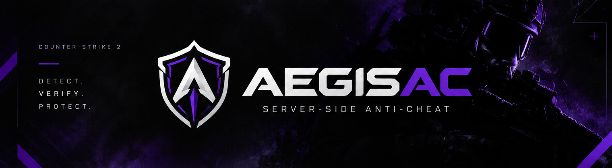

# AegisAC

<p align="center">
  
</p>

<p align="center">
  <strong>Detect. Verify. Protect.</strong>
  <br>
  Server-side anti-cheat for Counter-Strike 2, built with SwiftlyS2.
</p>

<p align="center">
  
  
  
  
</p>

---

## Overview

AegisAC is an open-source, server-side anti-cheat for Counter-Strike 2, built on SwiftlyS2.

The project aims to detect suspicious player behavior through server-side analysis, starting with aim-related detection and an extensible module architecture.

> **Note:** AegisAC is in early development. Detection systems are experimental and require live-server testing before they can be considered reliable.

## Current Features

- **Modular Architecture** — Dedicated anti-cheat modules with centralized loading and unloading.
- **Aimbot Detection** — Initial detection logic analyzing player aim angles.
- **Server-Side Analysis** — Uses server-observed player data through SwiftlyS2 hooks.
- **Extensible Design** — Structured to support additional detection modules as development progresses.

## Design Principles

- **Server-side** — Analyze player behavior using server-observed data.
- **Evidence-driven** — Develop detection logic based on measurable behavior rather than assumptions.
- **Modular** — Keep detection systems independent and maintainable.
- **Reliable** — Prioritize accuracy and minimize false positives.
- **Open source** — Keep the implementation available for inspection and community contributions.

## Technology Stack

| Technology | Purpose |
| --- | --- |
| C# | Core implementation |
| .NET 10 | Runtime and framework |
| SwiftlyS2 | Counter-Strike 2 server integration |

## Getting Started

### Requirements

- Counter-Strike 2 dedicated server
- SwiftlyS2
- .NET 10 SDK for development
- A compatible server environment

### Installation

AegisAC is currently under development. Installation instructions will be added when a usable release is available.

### Development

Clone the repository:

```bash
git clone https://github.com/ressiws/AegisAC.git
cd AegisAC
```

Open the solution in your preferred C# IDE and build the project using the repository's configured build process.

## Roadmap

### In Progress

- [x] Modular anti-cheat architecture
- [x] Initial aimbot detection module
- [ ] Live-server validation and detection tuning
- [ ] False-positive evaluation

### Planned

- [ ] Additional detection modules
- [ ] Configurable detection thresholds
- [ ] Configurable punishment policies
- [ ] Improved detection logging and diagnostics
- [ ] Documentation and release packages

## Contributing

Contributions, bug reports, and feature suggestions are welcome.

Please open an issue before starting major changes so the proposed approach can be discussed.

## License

See the [LICENSE](LICENSE) file for licensing information.

---

<p align="center">
  <strong>AegisAC — Detect. Verify. Protect.</strong>
</p>