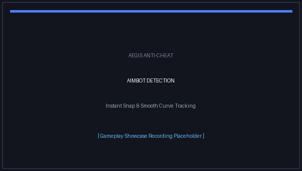
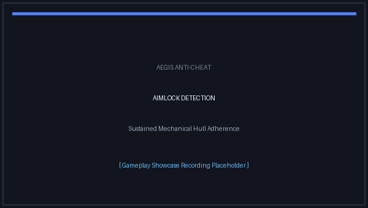
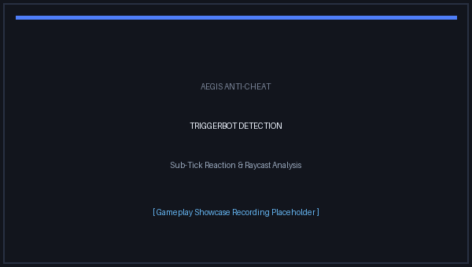

<div align="center">

<p align="center">
  
</p>

# AegisAC (Aegis Anti-Cheat)

**A Server-Sided Anti-Cheat for Counter-Strike 2 built with Swiflys2**

[](https://store.steampowered.com/app/730/CounterStrike_2/)
[](https://swiftlys2.net)
[](https://dotnet.microsoft.com/)
[](LICENSE)

<br/>

*A high-performance, non-intrusive server-side anti-cheat built with modern C# on the SwiftlyS2 framework. Detects aim assistance, abnormal angle convergence, and snaps without requiring any client-side software.*

---

</div>

## 📌 Table of Contents

- [Overview](#-overview)
- [Showcase](#-showcase)
- [Key Features](#-key-features)
- [Detection Modules & Strictness](#-detection-modules--strictness)
- [Commercial Anti-Cheat Reverse-Engineering & Mathematical Baselines](#-commercial-anti-cheat-reverse-engineering--mathematical-baselines)
- [Quick Start](#-quick-start)
  - [Prerequisites](#prerequisites)
  - [Installation](#installation)
  - [Building from Source](#building-from-source)
- [Configuration Reference](#-configuration-reference)
- [Server Commands](#-server-commands)
- [Discord Webhook Notifications](#-discord-webhook-notifications)
- [Community Calibration & Telemetry](#-aegistelemetry--community-driven-calibration)
- [Frequently Asked Questions (FAQ)](#-frequently-asked-questions-faq)
- [Contributing](#-contributing)
- [License](#-license)

---

## 📖 Overview

**AegisAC** provides servers with robust, automated detection against aimbots, triggerbots, and unnatural aim-locking mechanics in Counter-Strike 2. Unlike invasive kernel-level drivers or third-party client anti-cheats, AegisAC runs **strictly on the server**:

- **Zero Client Overhead:** Players do not need to download or install background software.
- **Sub-Tick Phase Aware:** Designed from the ground up to operate seamlessly with CS2's usercmd and sub-tick architecture.
- **Evidence-Based Sanctions:** Punishments are only executed when multiple, high-confidence evidence points are collected across a sliding time window, mitigating false positives.
- **Extensible Architecture:** Modular design allowing server owners to select independent punishment types (`ban`, `kick`, or `none`) for each detection module.

---

## 🎥 Showcase

<table>
<tr>
<td width="33.3%" align="center">

<br><strong>AIMBOT</strong><br>
<sub>Damaging shots following blatant angular snaps and unnatural curve smoothing onto target hitboxes.</sub>
</td>
<td width="33.3%" align="center">

<br><strong>AIMLOCK</strong><br>
<sub>Crosshair adhering mechanically to a moving enemy with sustained ≥95% hull coverage.</sub>
</td>
<td width="33.3%" align="center">

<br><strong>TRIGGERBOT</strong><br>
<sub>Instantaneous weapon discharges (≤90ms command delta) upon crosshair intersection with enemy targets.</sub>
</td>
</tr>
</table>

---

## ✨ Key Features

- **🎯 Advanced Trajectory & Angle Math:** Employs forward vector trigonometry, angular distance delta checking, and historical position reconciliation to detect instantaneous snaps and unnatural aimbot movement.
- **🔄 Sub-Tick & Phase-Compensated Correlator:** Reliably pairs `weapon_fire` and `player_hurt` events with exact user commands, compensating for client tick gaps and engine phase shifts.
- **⚖️ Modular Punishment System:** Configure punishments per module (`ban`, `kick`, `none`) with custom command templates supporting placeholders (`{userid}`, `{steamid}`, `{name}`, `{reason}`).
- **🔔 Discord Webhook Integration:** Instant, rich embed alerts dispatched asynchronously to your staff Discord channel when a player is flagged, kicked, or banned.
- **⚡ Hot Reloading & Live Config:** Reload configurations instantaneously during live gameplay with the `aegis_reload` command without restarting the server or kicking players.
- **🔍 Unified Diagnostic Mode:** Single global debug mode across the entire plugin for clean console logs and transparent troubleshooting.

---

## 🛡️ Detection Modules & Strictness

AegisAC is designed with a **low false-positive** philosophy. The table below outlines active and planned modules along with their detection mechanics and strictness levels.

<details open>
<summary><b>Active Module: Aimbot Detection (Click to collapse/expand)</b></summary>
<br/>

The Aimbot detector inspects user commands, view angles, weapon fire correlation, and player damage to identify automated targeting mechanics.

### Detection Methods

1. **Convergence Snap Detection**
   - **How it works:** Analyzes the angular delta between the player's view angles before and after a shot. If the aim jumps directly toward an enemy's exact hitboxes in a single tick (e.g. > 10° snap onto target), it is flagged as convergence.
   - **Trigger Condition:** Shot must inflict confirmed damage (`player_hurt`), target distance must exceed `100.0` game units, and aim must resolve directly onto enemy position.

2. **Snap-Return Detection**
   - **How it works:** Detects "silent" or snap-return aimbots that jump onto a target to fire a lethal shot and immediately snap back to the previous view angle within adjacent ticks.
   - **Trigger Condition:** Single-command angular jump onto the enemy followed by an immediate return to prior view angles.

3. **Smooth Convergence Detection**
   - **How it works:** Identifies mathematical curve-smoothing aimbots. Evaluates path efficiency, angular step consistency, and final terminal error against calibrated human aiming envelopes.
   - **Trigger Condition:** Step efficiency ≥ 94% with progressive angular improvement terminating under 1.0° from target center.

### Strictness Rating

| Metric | Setting / Behavior |
| :--- | :--- |
| **Strictness Level** | **Conservative (High Precision)** |
| **Evidence Window** | 5 Minutes (Sliding) |
| **Evidence Threshold** | 3 Verified Damaging Incidents required |
| **Damage Gate** | Active — shots that miss or do zero damage never accumulate incident counts |
| **Distance Gate** | Active — point-blank combat (< 100 units) is excluded from snap calculation |
| **False-Positive Profile** | Highly resilient against legitimate high-sensitivity flicks and swipe resets |

</details>

<details open>
<summary><b>Active Module: Triggerbot Detection (Click to collapse/expand)</b></summary>
<br/>

The Triggerbot detector inspects real-time crosshair raycast targeting, sub-tick reaction latencies, angle-holding behavior, and smoke boundary occlusion.

### Detection Methods

1. **Sub-Tick Reaction Timing Analysis**
   - **How it works:** Tracks when an enemy enters the player's crosshair while holding an angle (`TargetDriven`). Compares the exact target acquisition command to the sub-tick command where the weapon discharged.
   - **Trigger Condition:** Command delta ≤ `MaxReactionTimeMs` (calibrated default: ≤ 90ms / ~5-6 ticks at 64-tick), excluding aim-driven flicks, pre-fires, or active weapon sprays.

2. **Multi-Incident Evidence System**
   - **How it works:** Follows the same evidence-based structure as Aimbot. Each verified damaging shot with unnatural command delta records 1 triggerbot incident.
   - **Trigger Condition:** Accumulating `EvidenceThreshold` (calibrated default: 4) verified incidents within a 5-minute sliding window triggers the configured punishment.

3. **Smoke & Line-of-Sight Safety Gates**
   - **World Visibility Gate:** Performs targeted line-of-sight checks against world geometry (`MaskTrace.Solid`). Targets behind walls or where line-of-sight cannot be confirmed are safely ignored to eliminate wallbang penetration false positives.
   - **Smoke Occlusion:** Dynamically tracks smoke grenade detonation coordinates and volumetric boundaries. Automatically discards shots through active smokes or during uncertain map-load smoke states.

### Strictness Rating

| Metric | Setting / Behavior |
| :--- | :--- |
| **Strictness Level** | **Conservative (High Precision)** |
| **Evidence Window** | 5 Minutes (Sliding) |
| **Evidence Threshold** | 4 Verified Damaging Incidents required |
| **Max Command Delta** | ≤ 90ms (~5-6 Ticks at 64-tick) |
| **Damage Gate** | Active — evaluated strictly upon confirmed `player_hurt` events |
| **Line-of-Sight Gate** | Active — candidates verified against world geometry (`MaskTrace.Solid`) |
| **Smoke Exclusion** | Active — automated ray-box smoke volume intersection check |

</details>

<details open>
<summary><b>Active Module: Aimlock Detection (Click to collapse/expand)</b></summary>
<br/>

The Aimlock detector analyzes sustained crosshair adherence, lag-compensated target tracking, and mechanical angle locking while enemies move across the screen.

### Detection Methods

1. **Continuous Angular Error & Hull Tracking**
   - **How it works:** Analyzes the player's view angles against enemy player hull boundaries across 3 distinct body heights (lower torso: `8.0`, chest: `46.0`, head: `64.0`) over a sliding 1.95-second tracking window (`125` ticks at 64-tick).
   - **Trigger Condition:** Sustained crosshair placement covering ≥ 95% of ticks (`MeetsCoverage`) within the enemy bounding hull while the enemy traverses across the player's screen.

2. **Lag-Compensated Multi-Hypothesis Verification**
   - **How it works:** Evaluates target position against 5 distinct historical latency hypotheses (including client ping latency + tick interpolation) using the shared position buffer.

3. **False-Positive Prevention Gates**
   - **Distance Gate:** Point-blank interactions (< 200 units) are excluded to prevent false triggers during close-quarters body blocks.
   - **Target Traversal Gate:** Requires the enemy to have moved at least 128 units (~4 player widths) across the player's visual field to eliminate false positives on stationary or corner-holding targets.

### Strictness Rating

| Metric | Setting / Behavior |
| :--- | :--- |
| **Strictness Level** | **Conservative (High Precision)** |
| **Evidence Window** | 5 Minutes (Sliding) |
| **Evidence Threshold** | 3 Verified Tracking Incidents required |
| **Tracking Window** | 1.95 Seconds (~125 ticks at 64-tick) |
| **Hull Coverage** | ≥ 95% on-target consistency |
| **Min Target Travel** | > 128.0 units (~4 player widths) |

</details>

<details>
<summary><b>Planned Modules (Roadmap)</b></summary>
<br/>

- **Anti-Untrusted / Impossible Angles:** Flags invalid view angles (out-of-bounds Pitch, Yaw, Roll, NaN/Infinity exploits). *(Strictness: Aggressive / Instant)*
- **Movement / Anti-Bhop & Duck-Spam:** Detects automated jump timing, scroll-wheel automation, and desync duck-spam movement scripts. *(Strictness: Moderate)*
- **Dormant ESP / Server-Side Visibility Culling:** Suppresses network transmission of dormant enemy player pawns behind walls. *(Strictness: Active Mitigation)*

</details>

---

## 🔬 Commercial Anti-Cheat Reverse-Engineering & Mathematical Baselines

AegisAC's mathematical bounds and heuristic tolerances are not arbitrary guesses. In addition to empirical live telemetry collected across real community matches via **AegisTelemetry**, our core detection algorithms incorporate reverse-engineered heuristics and state-machine principles from industry-leading anti-cheats—specifically **Riot Vanguard** and **Blizzard Overwatch**.

By extracting and modeling the physical boundaries enforced by commercial anti-cheats, AegisAC implements high-precision mathematical gates that distinguish human motor capabilities from software automation:

| Reverse-Engineered Metric | Origin & Baseline | AegisAC Implementation & Calibration | Detection Target |
| :--- | :--- | :--- | :--- |
| **`SNAP_TRESHOLD`** | **Riot Vanguard** ($\ge 90.0^\circ$ in $<16\text{ms}$) | **Blatant Rage Snap Gate:** Single-tick ($15.6\text{ms}$) angular snaps $\ge 90.0^\circ$ terminating directly on an enemy trigger instant high-confidence detection. Calibrated subtle convergence starts at $26.0^\circ$ ($P_{99}$ live margin). | Blatant Aimbot / Silent Aim |
| **`MIN_HUMAN_REACTION`** | **Riot Vanguard** ($150\text{ ms}$ biological floor) | **Conservative $90.0\text{ ms}$ Command Delta:** Simple visual reaction time has an absolute human psychophysical floor of $\sim 150\text{ms}$. AegisAC enforces an ultra-conservative $90\text{ms}$ command-to-acquisition threshold ($25\%$ below even human $P_{01}$ outliers) to eliminate false flags. | Triggerbot / Auto-Fire |
| **`INPUT_STATE_MACHINE`** | **Blizzard Overwatch** (Impossible Transitions) | **Synthetic Input Anomaly Gate:** A physical mouse microswitch cannot mechanically transition $\text{Down} \to \text{Down}$ without an intervening $\text{Up}$, nor can human hands complete click-release-click cycles in $\le 31.2\text{ms}$ ($\le 2$ ticks). Synthetic injections (`SendInput`, virtual drivers) are flagged as automated input anomalies. | External Triggerbots / Injected Scripts |
| **`MACRO_TRESHOLD`** | **Riot Vanguard** ($\sigma^2 < 0.01$ cadence variance) | **Click Cadence Variance Analysis:** Human motor response exhibits natural biological jitter ($\sigma^2 > 0.05$). Automated scripts and macros fire with near-zero timing variance ($\sigma^2 < 0.01$), flagged automatically in the multi-incident evaluator. | Click Macros / Rapid-Fire |
| **`MIN_CLICK_VARIANCE`** | **Riot Vanguard** ($\sigma^2 < 0.05$) | **Mechanical Cadence Gate:** Flagged in Triggerbot multi-incident reports when repetitive attack commands exhibit machine-like consistency ($\sigma^2 < 0.05$). | Triggerbot / Macro |
| **`PREDICTION_TRESHOLD`**| **Riot Vanguard** ($> 95\%$ trajectory correlation) | **Smooth Path Efficiency & Aimlock:** Trajectory linearity gate `SmoothMinimumPathEfficiency = 0.96` ($96\%$) and Aimlock coverage gate `MeetsCoverage = 95%`. | Smooth Aimbot / Aimlock |
| **`MIN_VARIANCE`** | **Riot Vanguard** ($\sigma^2 < 0.05$ angular micro-stutter) | **Mechanical Trajectory Smoothing:** Validated in our monotonic angular decay checks ($Steps \ge 3$ with constant delta reduction). | Bot / Linear Aim Interpolation |

> [!TIP]
> **Why this matters**: While client-side kernel anti-cheats rely on invasive driver hooks to inspect processes, **AegisAC achieves the same empirical mathematical precision 100% server-side**, preserving player privacy, preventing native crashes, and eliminating client-side performance degradation.

---

## 🚀 Quick Start

### Prerequisites

- Counter-Strike 2 Dedicated Server.
- [.NET 10.0 Runtime](https://dotnet.microsoft.com/download/dotnet/10.0) installed on the host machine.
- [SwiftlyS2 Framework](https://swiftlys2.net/) (v1.1.6 or newer) installed in `game/csgo/addons/swiftlys2`.

### Installation

1. Download the latest release `.zip` from the [Releases](https://github.com/swisser/AegisAC/releases) page.
2. Extract the archive into your server's plugin directory:
   ```
   game/csgo/addons/swiftlys2/plugins/AegisAC/
   ```
3. Start or restart your server. SwiftlyS2 will automatically detect and load `AegisAC.dll`.
4. On first load, AegisAC automatically generates the default configuration file:
   ```
   game/csgo/addons/swiftlys2/configs/plugins/AegisAC/config.jsonc
   ```

### Building from Source

To compile the plugin locally:

```bash
# Clone the repository
git clone https://github.com/swisser/AegisAC.git
cd AegisAC

# Build in Release configuration
dotnet build -c Release

# Package and publish
dotnet publish -c Release
```

The compiled binaries will be output to `build/publish/AegisAC/`.

---

## ⚙️ Configuration Reference

AegisAC configurations are stored in `addons/swiftlys2/configs/plugins/AegisAC/config.jsonc`. The file supports comments (`//`) and auto-populates missing keys on server startup.

```jsonc
{
  "AegisAC": {
    // Global debug mode for Aegis Anti-Cheat. Enables verbose diagnostic logs in server console.
    "Debug": false,

    // Command executed when kicking a player.
    // Available placeholders: {userid}, {steamid}, {name}, {reason}
    "KickCommand": "kickid {userid} \"[AegisAC] {reason}\"",

    // Command executed when banning a player.
    // Available placeholders: {userid}, {steamid}, {name}, {reason}
    "BanCommand": "banid 0 {steamid}; writeid; kickid {userid} \"[AegisAC] {reason}\"",

    // Aimbot detection module configuration
    "Aimbot": {
      // Enable or disable aimbot detection
      "Enabled": true,

      // Punishment applied upon detection: "none", "kick", or "ban" (keep "none" during server calibration)
      "Punishment": "none",

      // Treat teammates as enemies (useful for FFA / Deathmatch servers)
      "TeammatesAreEnemies": false,

      // Calibrated single-tick snap threshold in degrees
      "SnapAngleThreshold": 26.0,

      // Minimum total angular movement in degrees for smooth aimbot trajectory
      "SmoothMinimumMovement": 12.0,

      // Minimum path efficiency ratio (0.0 to 1.0)
      "SmoothMinimumPathEfficiency": 0.96
    },

    // Triggerbot detection module configuration
    "Triggerbot": {
      // Enable or disable triggerbot detection
      "Enabled": true,

      // Punishment applied upon detection: "none", "kick", or "ban" (keep "none" during server calibration)
      "Punishment": "none",

      // Number of unnatural triggerbot reaction incidents within 5 minutes required to punish (calibrated default: 4)
      "EvidenceThreshold": 4,

      // Maximum reaction time in milliseconds considered an unnatural triggerbot reaction (calibrated default: 90ms)
      "MaxReactionTimeMs": 90.0,

      // Verify direct world line-of-sight using native physics raycasts
      "EnableNativeTrace": true
    },

    // Aimlock detection module configuration
    "Aimlock": {
      // Enable or disable aimlock detection
      "Enabled": true,

      // Punishment applied upon detection: "none", "kick", or "ban" (keep "none" during server calibration)
      "Punishment": "none",

      // Number of aimlock tracking incidents within 5 minutes required to punish
      "EvidenceThreshold": 3,

      // Duration in seconds of uninterrupted mechanical tracking required for an aimlock episode (calibrated default: 1.95s)
      "TrackingDurationSeconds": 1.95,

      // Minimum distance in units between player and target to evaluate tracking (default: 200.0 units)
      "MinimumDistance": 200.0,

      // Minimum traversal in units the target must move across view to eliminate stationary false positives (default: 128.0 units)
      "MinimumTargetTravel": 128.0
    },

    // Discord webhook notifications
    "Discord": {
      // Enable or disable Discord alert embeds
      "Enabled": false,

      // Discord webhook URL to send detection notifications
      "WebhookUrl": "https://discord.com/api/webhooks/YOUR_WEBHOOK_URL_HERE"
    }
  }
}
```

---

## 💻 Server Commands

All commands can be executed via the server console or in-game by authorized administrators (`@css/root`).

| Command | Aliases | Permission | Description |
| :--- | :--- | :--- | :--- |
| `aegis_reload` | `aegisreload` | `@css/root` | Reloads `config.jsonc` dynamically without restarting the server. |
| `aimbot_status` | — | `@css/root` | Prints real-time aimbot detector statistics and buffers (active only when `Debug: true` in config). |
| `triggerbot_status` | — | `@css/root` | Prints real-time triggerbot detector statistics and active smokes (active only when `Debug: true` in config). |
| `aimlock_status` | — | `@css/root` | Prints real-time aimlock detector statistics and tracking sessions (active only when `Debug: true` in config). |

---

## 🔔 Discord Webhook Notifications

AegisAC features native **Discord Components V2** webhook alerts with structured containers, dynamic accent colors, markdown formatting, and incident telemetry:

```
┌────────────────────────────────────────────────────────┐
│ 🛡️ Aegis Anti-Cheat  APP                               │
│ CS2 · Server-Sided Protection                          │
│ ────────────────────────────────────────────────────── │
│ 🚨 CHEATER DETECTED                                    │
│ Player Swisser has been flagged by Aegis Anti-Cheat.   │
│ ────────────────────────────────────────────────────── │
│ Player Information                                     │
│ PLAYER: Swisser                                        │
│ STEAM ID: 76561198...                                  │
│ MODULE: Aimbot                                         │
│ ────────────────────────────────────────────────────── │
│ Detection & Action                                     │
│ DETECTION: AIMBOT                                      │
│ ACTION TAKEN: 🔴 BANNED                                │
│ ────────────────────────────────────────────────────── │
│ 📊 Incident Evidence                                   │
│ 1. 47.52° sudden move (10.86° → 1.62°)                 │
│ 2. 82.14° sudden move (14.20° → 0.95°)                 │
│ 3. 123.28° sudden move (18.40° → 0.81°)                │
│ ────────────────────────────────────────────────────── │
│ AEGIS ANTI-CHEAT FOR CS2 · SERVER-SIDED PROTECTION     │
└────────────────────────────────────────────────────────┘
```

- **Non-blocking:** Embeds are dispatched in an asynchronous background worker pool, guaranteeing zero frame drops or lag spikes on the game thread.
- **Color-Coded:** Red for Bans, Orange for Kicks, Gold/Yellow for Logged alerts.
- **Steam Profile Links:** Direct clickable links to the flagged player's Steam Community profile.

---

## 📊 AegisTelemetry & Community-Driven Calibration

> **Every CS2 server community is unique.** A competitive 5v5 scrim server, an intensive FFA Deathmatch network, and a casual community feature vastly different player movement speeds, flick ranges, and reaction profiles.

To discover the optimal, false-positive-proof detection thresholds tailored specifically to **your community**, you can pair AegisAC with our companion open-source project: **[AegisTelemetry](https://github.com/ressiws/AegisTelemetry)**.

### What is AegisTelemetry?
[AegisTelemetry](https://github.com/ressiws/AegisTelemetry) is a dedicated SwiftlyS2 telemetry collector and interactive Web Dashboard designed to calibrate anti-cheat settings directly from live server data:

- 📡 **Silent Server Telemetry:** Records high-frequency sub-tick metrics (flick snap angles, mouse path efficiency, reaction times upon target intersection, continuous aimlock tracking durations) directly into MariaDB/MySQL without blocking the server game tick.
- 📈 **Interactive Web Dashboard:** Launch `AegisTelemetry.Dashboard` to visualize real-world percentile distributions ($P_{50}$, $P_{90}$, $P_{95}$, $P_{99}$) and histograms across all weapons and maps.
- 🥷 **Cheater Intelligence & Quarantine:** Automatically isolates abnormal outliers (blatant snaps $\ge 26^\circ$, reaction times $< 85\text{ms}$) into a quarantined investigation panel so rogue players never pollute your legitimate baseline.
- ⚙️ **One-Click Threshold Export:** Derives safe, mathematically sound `SnapAngleThreshold`, `MaxReactionTimeMs`, and `TrackingDurationSeconds` thresholds with built-in safety margins, ready to paste straight into your `AegisAC` configuration.

👉 Learn more and set up your community calibration pipeline at **[github.com/ressiws/AegisTelemetry](https://github.com/ressiws/AegisTelemetry)**.

---

## ❓ Frequently Asked Questions (FAQ)

<details>
<summary><b>Does AegisAC require any client downloads or VAC-incompatible binaries?</b></summary>
<br/>
No. AegisAC is 100% server-sided. It operates purely on user commands and entity state data sent by the standard CS2 client. It does not tamper with client memory, DLLs, or VAC.
</details>

<details>
<summary><b>How does AegisAC handle CS2's Sub-Tick mechanics?</b></summary>
<br/>
CS2 usercmds include historical attack viewangles and sub-tick timestamps. AegisAC reconciles these timestamps during `ProcessUsercmds` and movement simulation (`SetupMove`), compensating for client-tick gaps and phase differences before evaluating aim trajectories.
</details>

<details>
<summary><b>Can legitimate players with high DPI or flick aim get false-banned?</b></summary>
<br/>
No. AegisAC requires **3 separate damaging incidents within a 5-minute window** to trigger a punishment. Random fast flicks or crosshair adjustments that do not resolve into unnatural single-tick hitbox convergence accompanied by confirmed damage are filtered out.
</details>

<details>
<summary><b>Can I test detections without automatically banning players?</b></summary>
<br/>
Yes! Simply set `"Punishment": "none"` in your `config.jsonc`. Detections will still be announced in the console and sent to your Discord webhook without taking action against the player.
</details>

<details>
<summary><b>Does AegisAC cause server lag or drop tick rate?</b></summary>
<br/>
No. All player command buffers and position frames are stored in fixed-size circular arrays, and computationally heavy operations (such as HTTP Discord webhooks) run completely off the game thread.
</details>

---

## 🤝 Contributing

Contributions, bug reports, and suggestions are welcome!

1. **Reporting Issues:** If you encounter unexpected behavior or want to suggest an improvement, please open an issue on the GitHub Issues page.
2. **Submitting Pull Requests:**
   - Fork the repository and create your feature branch: `git checkout -b feature/my-feature`.
   - Maintain the existing code style: **C# 13**, strictly in **English**, with meaningful docstrings and zero unnecessary comments.
   - Verify that your changes build cleanly with `dotnet build`.
   - Commit and submit a Pull Request describing your modifications.

---

## 📄 License & Attribution

This project is licensed under the **[Apache License 2.0](LICENSE)**.

### Attribution Requirement
Under Section 4 of the Apache 2.0 license and the accompanying [`NOTICE`](NOTICE) file, any redistribution, modification, fork, or inclusion of this project must:
1. Retain all original copyright, patent, trademark, and attribution notices.
2. Prominently display attribution and credit to the original authors (**swisser & sevon**).
3. State any modifications made to the source files.
